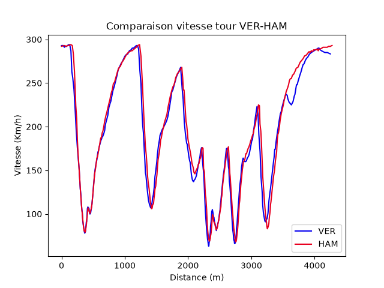
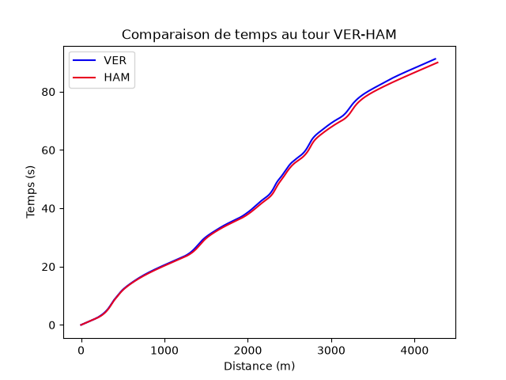
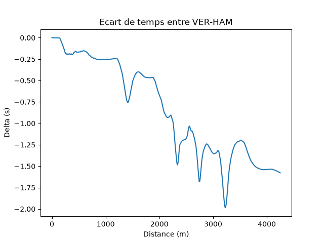

# Comparaison de télémétrie F1

Compare deux pilotes sur leur meilleur tour en qualifications
avec FastF1, numpy et matplotlib.

## Ce que fait le programme
- Vitesse des deux pilotes en fonction de la distance
- Temps écoulé en fonction de la distance
- Écart de temps tout au long du tour

## Résultat

## Lancer le projet
pip install fastf1 matplotlib
python graphique.py

## Conclusions
HAM est plus rapide d'environ 1,3 s sur son meilleur tour. L'écart se creuse surtout
en fin de tour, dans les virages lents vers 2 700 m et 3 200 m, puis sur la dernière
ligne droite. Écart négatif = HAM devant.